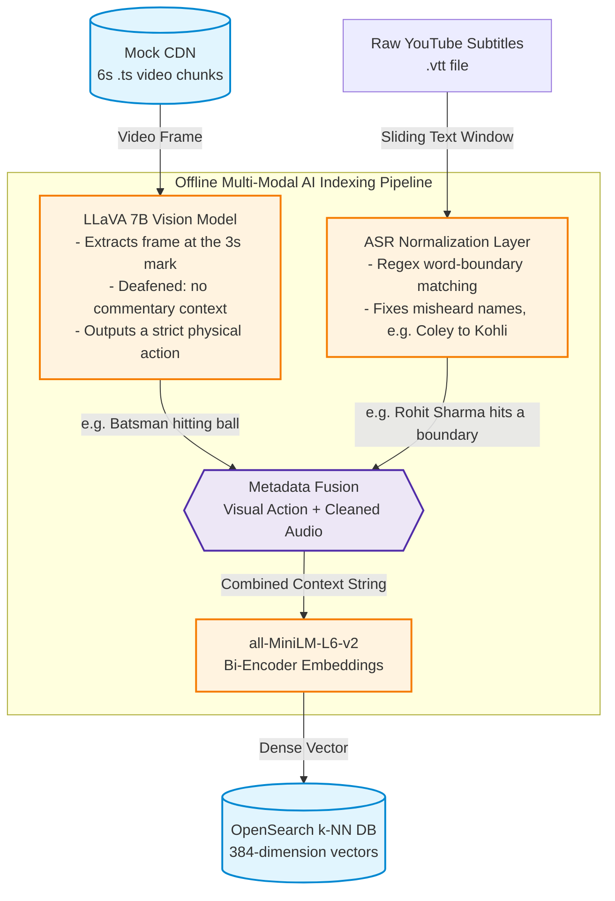
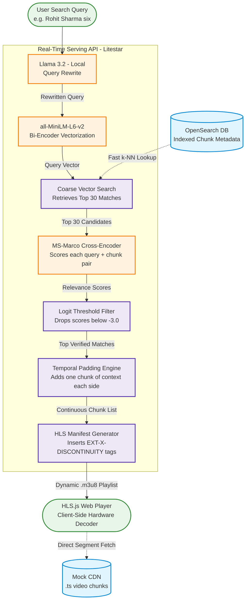

# SemanticStream: Zero-Render Video RAG for Dynamic Sports Highlights

When exploring interesting applications of AI, live sports stood out immediately.

Compared to movies, sports broadcasts face a glaring personalization gap. In entertainment, platforms cater to endless micro-tastes: audiences choose horror, drama, or comedy depending on the specific emotional "high" they seek. Sports broadcasting, by contrast, remains strictly one-size-fits-all.

After a match, networks release a generic highlight package reflecting what the *broadcaster* considers critical. As a viewer, individual interests are often far more specific: watching every variation from a particular spell, tracking fielding transitions, or observing a player's celebrations. Those granular moments consistently end up on the cutting room floor.

**SemanticStream** bridges that gap.

A user submits a natural-language description of the moments they want to see (e.g., *"Rohit Sharma hitting a six"* or *"Kohli celebrating"*). The system identifies the relevant segments and serves a personalized highlight reel instantly.

Crucially, it executes at runtime with **Zero Server-Side Video Compute** via **Client-Side HLS Assembly**: the backend never decodes, stitches, or re-encodes media.

---

## System Architecture & Flows

### 1. The AI Context Engine (Offline Ingestion & Tagging)

This flowchart outlines how the system extracts, sanitizes, and fuses multimodal intelligence to "understand" what happens inside each 6-second video chunk.



### 2. The Zero-Compute Delivery Engine (Runtime API & Assembly)

This flowchart demonstrates the real-time search mechanics: how the API retrieves indexed chunks, applies precise reranking, and generates the text manifest that offloads video stitching to the client browser.



---

## ⚙️ The Non-AI Layer: Zero-Compute Streaming Infrastructure

### Offline: The Headless CDN & The Keyframe Defect

To store and deliver video, FFmpeg segments the raw broadcast into uniform MPEG transport stream (`.ts`) files, mocking a static CDN structure.

The initial baseline pass used a rapid codec copy (`-c copy`). That caused complete video failure: players output audio over a static black screen.

Standard broadcast compression inserts full intra-coded frames (I-frames / keyframes) only every 3 to 5 seconds. When segments were sliced strictly by wall-clock time without forcing a keyframe at the start of each segment, media players lacked the reference picture required to render the video track.

The FFmpeg pipeline was re-architected to transcode with `libx264` and `aac`, forcing a keyframe exactly on every 6-second segment boundary:

```bash
ffmpeg -i input.mp4 \
  -c:v libx264 -c:a aac \
  -force_key_frames "expr:gte(t,n_forced*6)" \
  -f hls -hls_time 6 -hls_list_size 0 \
  -hls_segment_filename "cdn_mock/match_%03d.ts" \
  cdn_mock/dummy.m3u8
```

This ensures every chunk starts with an instantaneous keyframe, rendering each segment fully self-contained and playable. (`indexer/download_chunk.py` runs the equivalent command through `ffmpeg-python`.)

### Online: The Manifest Router & Client-Side Stitching

Conventional highlight generation invokes server-side workers to cut, merge, and re-render target segments into an `.mp4` container. Scaled across thousands of concurrent sports fans, runtime transcoding creates massive CPU/GPU bottlenecks and introduces multi-second latency.

SemanticStream treats chunks on the CDN as immutable static assets. The runtime API, built on the Litestar asynchronous framework, never touches media payloads. It acts purely as a text router:

1. It queries OpenSearch to retrieve matching chunk index numbers.
2. It concatenates the segment URLs into a raw text playlist (`.m3u8`).
3. It hands the manifest to the browser over HTTP.

```text
#EXTM3U
#EXT-X-VERSION:3
#EXT-X-TARGETDURATION:6
#EXT-X-MEDIA-SEQUENCE:0
#EXTINF:6.0,
http://localhost:8000/cdn/match_015.ts
#EXT-X-DISCONTINUITY
#EXTINF:6.0,
http://localhost:8000/cdn/match_120.ts
#EXT-X-ENDLIST
```

### Preventing Decoder Crashes

Non-sequential playback creates significant timestamp jumps: jumping directly from chunk 15 (minute 1:30) to chunk 120 (minute 12:00) causes native video decoders to treat the stream as corrupted and halt playback.

The API compares consecutive chunk indices and injects `#EXT-X-DISCONTINUITY` tags between non-adjacent segments. This instructs client decoders (via hls.js) to flush their buffers, reset presentation timestamps (PTS), and continue playing across sequence breaks without stutter. The client's hardware decoder handles the stitching, resulting in zero server-side rendering overhead.

---

## 🧠 The AI Layer: True Decoupling & Two-Tier Retrieval

### Multimodal Decoupling (Deafening the Vision Model)

Small open-weight multimodal models (such as LLaVA 7B) struggle when tasked with simultaneous image parsing and complex text reasoning.

Initially, single frames were passed alongside raw commentary subtitles, prompting the model to generate unified descriptions. This caused severe hallucinations. When a transcript stated *"Savage length to Ashton... Charges,"* the model parsed the capitalized verb as an entity, inventing an imaginary player named "Ashton Charges."

To resolve this, the vision model was completely decoupled from textual commentary:

- **LLaVA is kept "deaf":** LLaVA evaluates visual frames with zero linguistic context, acting exclusively as a visual classifier for physical actions (e.g., *"Batsman hitting ball"*, *"Umpire raising finger"*, *"Fielder sliding"*).
- **Downstream fusion:** Python handles metadata fusion by appending the cleaned commentary transcript to the vision model's output:

  ```python
  text_to_embed = f"{visual_action}. Commentary: {sanitized_audio}"
  ```

- **OpenSearch vectorization:** The fused string is embedded with `all-MiniLM-L6-v2` into an OpenSearch k-NN index using Lucene-backed HNSW graphs. The visual tag acts as an action anchor, while the commentary supplies the named entities.

Every chunk is indexed, not only the ones the vision model labels as highlights. LLaVA tags most frames as `normal_play` (including many sixes and wickets), so filtering on its labels would hide most of the match from search. Relevance filtering happens at query time in the Cross-Encoder instead.

### ASR Normalization

Automated Speech Recognition (ASR) engines routinely distort phonetic cricket terminology and non-Western player names. Transcripts frequently output "Coley" or "Coli" for Kohli, "Bumra" or "Boomerra" for Bumrah, "Sally" for Southee, and "K Rail" for KL Rahul.

Because Cross-Encoders evaluate token-level semantics, these misspellings cause valid retrievals to fail similarity thresholds. Before vectorization, raw transcripts pass through an ASR sanitization layer using regex word-boundary mapping:

```python
ASR_CORRECTIONS = {
    "bumra": "Bumrah", "boomerra": "Bumrah",
    "coli": "Kohli", "coley": "Kohli",
    "sally": "Southee", "saudi": "Southee",
    "k rail": "KL Rahul", "ciphert": "Seifert",
}

def clean_asr_text(text: str) -> str:
    for wrong, right in ASR_CORRECTIONS.items():
        text = re.sub(rf"\b{wrong}\b", right, text, flags=re.IGNORECASE)
    return text
```

Keys are kept to three or more letters: very short keys (such as "ro" or "sa") match ordinary words and syllables and corrupt the transcript.

### Two-Tier Search: Expansion, Retrieval, and Cross-Encoder Reranking

User inputs are often concise or incomplete (e.g., *"Sharma"* or *"Shami wicket"*). The retrieval system processes searches through a three-stage pipeline:

1. **Pre-search query expansion (Llama 3.2):** A local text model rewrites unstructured user queries into focused action descriptions, without inventing verbs or introducing poetic framing.
2. **Coarse vector retrieval (Bi-Encoder):** The expanded query is converted into a 384-dimensional dense vector. OpenSearch runs an approximate nearest-neighbour (ANN) search, quickly returning a candidate pool of the top 30 chunks.
3. **Post-search precision reranking (Cross-Encoder):** Bi-encoders embed queries and documents independently and can miss deeper relevance. The candidate pool is passed to `cross-encoder/ms-marco-MiniLM-L-6-v2`, which reads the query and segment text together and produces a relevance logit. Candidates scoring above a **-3.0** logit floor are retained; the rest are discarded as false positives.

---

## 🚧 Key Engineering Takeaways (Post-Mortem)

### 1. The Chunk Size Trap: Streaming Latency vs. AI Semantic Boundaries

In standard HLS live streaming, 2-second chunks minimize buffer bloat and keep end-to-end latency low. In a Video RAG system, however, the chunk is the atomic unit of machine-learning context.

At 2 seconds, media segments fragmented commentary sentences and cut off physical plays, separating a bowler's run-up from the delivery stride or splitting the bat stroke from the boundary catch. The vision model was frequently blinded, leading to ungrounded classifications.

Moving to 6-second segments aligned the chunk boundary with the natural duration of a single cricket play (run-up → delivery → shot → fielding action). It also gave subtitle windows enough duration to contain full sentences, stabilizing the vector embeddings.

### 2. Temporal Padding Prevents "Micro-Clips"

High-precision Cross-Encoders identify the specific 6-second window where an event occurs (such as the ball crashing into the stumps). Serving only that isolated chunk, however, gives a jarring experience with no setup or context.

To fix this, the API applies temporal padding, clamped so it never points before the first or past the last chunk on the CDN:

```python
expanded = set()
for idx in core_indices:
    for offset in range(-PAD_BEFORE, PAD_AFTER + 1):  # 1 chunk before (run-up), 1 after (reaction)
        expanded.add(min(MAX_CHUNK_INDEX, max(0, idx + offset)))
```

This expands single-chunk hits into continuous 18-second plays, capturing the delivery's approach, execution, and celebration. Adjacent hits merge naturally into longer sequences.

### 3. Graceful Empty Manifest Handling

When a user searches for an event or entity that is not in the footage, the Cross-Encoder correctly rejects all candidate chunks.

An `.m3u8` playlist with zero media segments makes client-side players hang or throw unhandled exceptions. The Litestar service checks the candidate list after filtering; if no chunks survive, it skips manifest creation and returns a clean `HTTP 404 Not Found`, and the UI shows a friendly message.

### 4. One Request per Search

Every request to `/search` runs the full AI pipeline (Llama rewrite, embedding, Cross-Encoder). The UI therefore fetches the manifest once, then hands the downloaded text to hls.js as a local blob URL instead of letting the player request it a second time. The search handler runs in a worker thread (`sync_to_thread=True`) because the model calls block, so one slow search never stalls segment delivery for other viewers.

---

## 🛠️ Local Development & Quickstart

### Prerequisites

- Docker & Docker Compose
- Python 3.11+
- FFmpeg (`sudo apt install ffmpeg`)
- [Ollama](https://ollama.com) with the models pulled:

  ```bash
  ollama pull llava
  ollama pull llama3.2
  ```

### 1. Install dependencies

```bash
python -m venv venv
source venv/bin/activate
pip install -r indexer/requirements.txt -r api/requirements.txt
```

### 2. Start the vector database

```bash
docker compose up -d
```

This starts a single-node OpenSearch instance on `localhost:9200` with the security plugin disabled for local testing.

### 3. Run the ingestion pipeline

```bash
# Downloads the match + YouTube captions, then slices 6s chunks with forced keyframes
python indexer/download_chunk.py

# Runs local LLaVA vision tagging and attaches the subtitle window for each chunk
python indexer/vision_tagger.py

# Cleans ASR transcripts, vectorizes every chunk, and writes them to OpenSearch
python indexer/vector_ingest.py
```

### 4. Run the serving API

```bash
uvicorn api.app:app --reload --port 8000
```

### 5. Open the player

Open `ui/index.html` in a browser, type a search (e.g. *"Kohli celebrating"*), and the personalized reel streams straight from the mock CDN.

---

## Project Structure

```text
semantic-stream/
├── api/
│   ├── app.py                # Litestar search API + manifest generator + /cdn static files
│   └── requirements.txt
├── indexer/
│   ├── download_chunk.py     # yt-dlp download + FFmpeg 6s HLS chunking
│   ├── vision_tagger.py      # LLaVA frame tagging + subtitle window extraction
│   ├── vector_ingest.py      # ASR cleanup, embeddings, OpenSearch k-NN indexing
│   └── requirements.txt
├── ui/
│   └── index.html            # Search box + hls.js player
├── data/                     # Git-ignored: raw video, .ts chunks, captions, tags
└── docker-compose.yml        # Local OpenSearch
```
